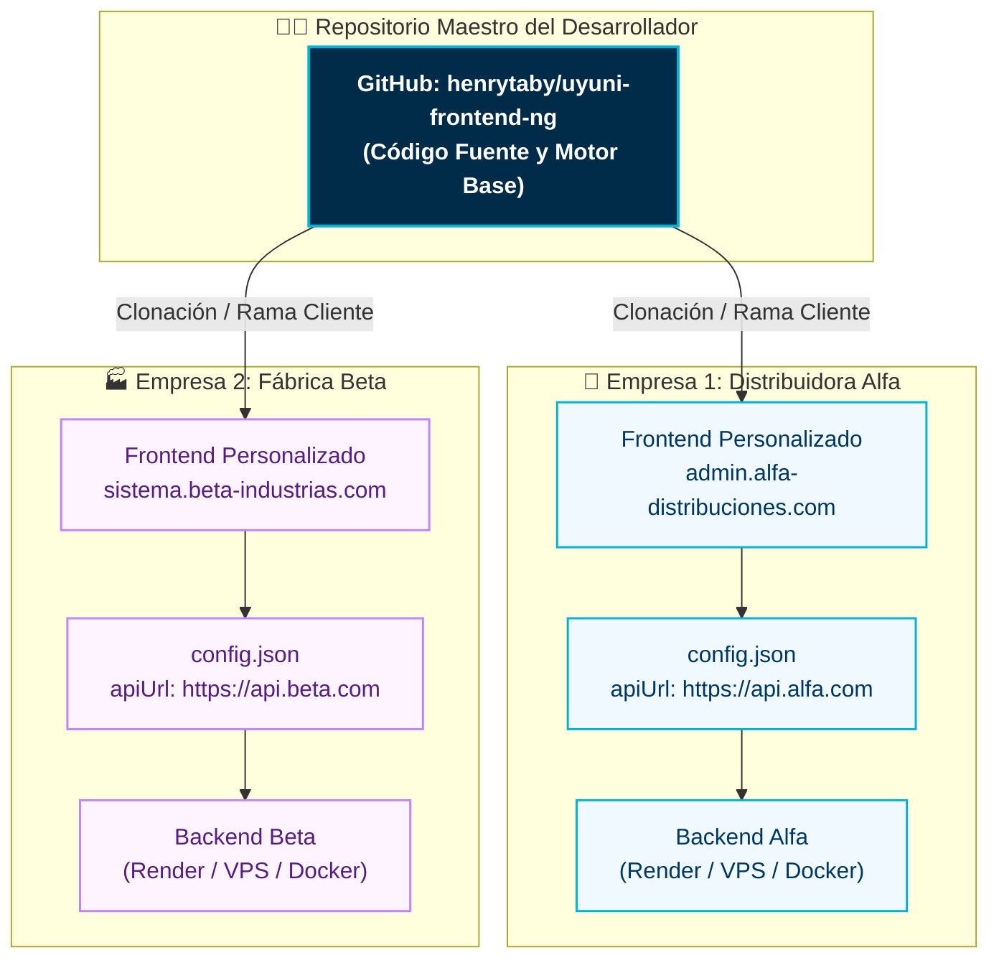

# Manual de Replicación Marca Blanca para Clientes — Uyuni Frontend

Este manual describe el procedimiento paso a paso para desplegar y personalizar una instancia frontend de **UyuniAdmin** para una nueva empresa o cliente bajo el modelo de arquitectura **Single-Tenant / Marca Blanca** (*White-Label*), garantizando aislamiento de configuración, dominio propio y adaptación visual en menos de 15 minutos.

---

## 🏛️ Topología de Clientes Marca Blanca

Cada empresa cliente dispone de su propio frontend personalizado que apunta a su backend dedicado:



---

## 📋 Checklist de Personalización para un Nuevo Cliente

Para dar de alta a un nuevo cliente, se personalizan únicamente 4 elementos:

1. **URL de API Dedicada (`config.json`)**
2. **Logotipo e Identidad Gráfica**
3. **Título de la Pestaña y Favicon (`index.html`)**
4. **Paleta de Color Primario de la Empresa (Opcional, en `app.config.ts`)**

---

## 🚀 Paso a Paso de Personalización

### Paso 1: Configurar la URL de API del Cliente (`config.json`)

Edita el archivo de configuración en `public/assets/config/config.json`:

```json
{
  "apiUrl": "https://api.empresa-cliente.com",
  "authConfig": {
    "loginUrl": "/auth/login",
    "tokenKey": "access_token",
    "refreshKey": "refresh_token"
  },
  "appVersion": "1.0.3",
  "loggingLevel": "warn",
  "featureFlags": {
    "enableSignup": false,
    "maintenanceMode": false,
    "mockAuth": false
  }
}
```

> [!TIP]
> **Sistemas Administrativos Cerrados:** Para empresas privadas donde los administradores dan de alta al personal manualmente, define `"enableSignup": false`. Esto ocultará automáticamente los botones y formularios de auto-registro en la pantalla de bienvenida.

---

### Paso 2: Personalizar Título y Favicon (`index.html`)

Abre `src/index.html`:

```html
<!doctype html>
<html lang="es">
<head>
  <meta charset="utf-8">
  <!-- Título personalizado de la empresa del cliente -->
  <title>Empresa Alfa — Panel Administrativo</title>
  <base href="/">
  <meta name="viewport" content="width=device-width, initial-scale=1">
  <link rel="icon" type="image/x-icon" href="favicon.ico">
  ...
```

Reemplaza `public/favicon.ico` con el ícono representativo de la marca del cliente.

---

### Paso 3: Reemplazar el Logotipo Corporativo

Los logotipos se ubican en la carpeta `public/images/logo/`:
* `public/images/logo/logo.svg` (Logotipo principal con texto)
* `public/images/logo/logo-icon.svg` (Ícono compacto para la barra lateral colapsada)

Simplemente sustituye estos archivos SVG por el arte provisto por el cliente, manteniendo las mismas dimensiones base.

---

### Paso 4: Ajustar la Paleta de Color Corporativo (Opcional)

Si el cliente requiere que los botones, bordes activos y elementos destacados reflejen su identidad de marca (ej. azul marino, verde esmeralda, naranja corporativo, etc.), edita `src/app/app.config.ts` en la definición de `MyPreset`:

```typescript
// src/app/app.config.ts
const MyPreset = definePreset(Aura, {
    semantic: {
        primary: {
            50: '#eef2ff',   // Tinte más claro
            100: '#e0e7ff',
            200: '#c7d2fe',
            300: '#a5b4fc',
            400: '#818cf8',
            500: '#6366f1',  // Color primario principal
            600: '#4f46e5',
            700: '#4338ca',
            800: '#3730a3',
            900: '#312e81',
            950: '#1e1b4b'   // Tinte más oscuro
        }
    },
    ...
});
```

---

### Paso 5: Despliegue para el Cliente

Elige la plataforma según el contrato del cliente:

1. **En Render.com ($0.00 / mes):**  
   Crea un nuevo **Static Site** vinculado a la rama del cliente, define Build Command: `npm install && npm run build`, Publish Directory: `dist/ng-uyuniadmin/browser`, configura la regla de reescritura SPA en **Redirects/Rewrites** (`/* -> /index.html` como `Rewrite`), asigna el dominio `admin.empresa.com` y publica siguiendo la [**Guía de Render**](./RENDER_DEPLOYMENT_GUIDE.md).
2. **En Vercel ($0.00 / mes):**  
   Crea un nuevo **Project** en Vercel, apunta el subdominio `admin.empresa.com` y publica siguiendo la [**Guía de Vercel**](./VERCEL_DEPLOYMENT_GUIDE.md).
3. **En VPS Nginx (Servidor Propio):**  
   Añade un nuevo bloque en Nginx:
   ```bash
   sudo nano /etc/nginx/sites-available/cliente-alfa-frontend
   ```
   Siguiendo la [**Guía de VPS Linux Ubuntu**](./UBUNTU_VPS_DEPLOYMENT_GUIDE.md).

---

## 🛡️ Lista de Verificación Previa a la Entrega al Cliente

Antes de entregar las credenciales de acceso a la empresa cliente, verifica:

* [ ] `mockAuth` está en `false` en `config.json`.
* [ ] La URL de la API en `config.json` utiliza HTTPS estricto.
* [ ] El inicio de sesión con JWT funciona y almacena el token en `localStorage`.
* [ ] La carga de foto de perfil y avatar se almacena en el servicio en la nube (Cloudinary) sin errores.
* [ ] Al recargar páginas internas (`/profile`, `/users`) no se producen errores 404.
* [ ] El favicon y el título de la pestaña muestran el nombre comercial del cliente.
* [ ] El certificado SSL está activo y sin advertencias de contenido mixto.

