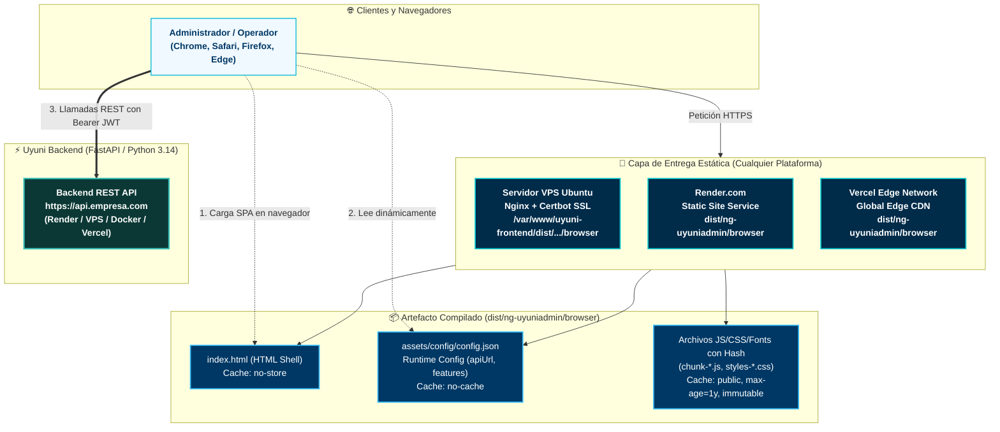

# 🚀 Suite de Despliegue, Infraestructura y Producción — Uyuni Frontend

Este directorio centraliza toda la documentación operativa, guías de infraestructura, manuales de puesta en producción y procedimientos de replicación marca blanca (*White-Label / Single-Tenant*) para el **Frontend de UyuniAdmin (Angular 21 + PrimeNG 21 + Tailwind v4)**.

---

## 📚 Mapa de Guías Disponibles

| Guía | Propósito | Entorno / Servicios | Costo Estimado |
| :--- | :--- | :--- | :---: |
| 🖥️ **[Guía de Despliegue en VPS Linux (Ubuntu + Nginx)](./UBUNTU_VPS_DEPLOYMENT_GUIDE.md)** | Instalación tradicional en servidor propio con Nginx de alto rendimiento, compresión Gzip/Brotli, políticas de caché inmutable, certificados SSL automáticos con Certbot y script de actualización continua. | Ubuntu 22.04/24.04 + Nginx + Certbot | Según proveedor VPS (~$3 - $10 / mes) |
| 🟣 **[Guía de Despliegue en Render.com](./RENDER_DEPLOYMENT_GUIDE.md)** | Despliegue continuo en Render como Static Site global. Construcción automática en cada `git push`, manejo nativo de SPA con `_redirects` y SSL automático. | Render Static Site + Global CDN | **$0.00 / mes** |
| ▲ **[Guía de Despliegue en Vercel](./VERCEL_DEPLOYMENT_GUIDE.md)** | Despliegue serverless optimizado en Vercel Edge Network. Integración nativa con GitHub, configuración de `vercel.json`, vistas previas por rama (PRs) y CDN perimetral ultra rápida. | Vercel Edge Network + Git Integration | **$0.00 / mes** |
| 🏢 **[Manual de Replicación Marca Blanca para Clientes](./CLIENT_REPLICATION_PLAYBOOK.md)** | Procedimiento paso a paso para desplegar un frontend personalizado para un nuevo cliente o empresa: configuración de logo, títulos, colores corporativos y enlace a la API dedicada vía `config.json`. | Multi-tenant / Marca Blanca | **$0.00 / mes** |

---

## 🏛️ Arquitectura de Despliegue y Conectividad

A diferencia de aplicaciones web tradicionales que acoplan el frontend con el servidor de aplicaciones, **UyuniAdmin** se compila como una **Single Page Application (SPA) 100% estática**:



---

## 💡 Filosofía de Configuración Dinámica (12-Factor App)

Un problema habitual en proyectos Angular clásicos es definir la URL del backend en archivos `environment.prod.ts` durante la compilación. Esto obliga a recompilar todo el proyecto (`npm run build`) para cada cliente o cada entorno (desarrollo, staging, producción).

### La Solución Uyuni: `ConfigService` en Tiempo de Ejecución

**Uyuni Frontend** implementa el estándar **12-Factor App**:
1. El proyecto se compila **una sola vez** (`npm run build`).
2. Al iniciar la aplicación en el navegador, `ConfigService` intercepta el arranque mediante `provideAppInitializer()` y consulta `assets/config/config.json`.
3. El archivo `config.json` inyecta la URL de la API de producción (`apiUrl`) y las opciones de sesión:

```json
{
  "apiUrl": "https://api.tuempresa.com",
  "authConfig": {
    "loginUrl": "/auth/login",
    "tokenKey": "access_token",
    "refreshKey": "refresh_token"
  },
  "appVersion": "1.0.3",
  "loggingLevel": "info",
  "featureFlags": {
    "enableSignup": true,
    "maintenanceMode": false,
    "mockAuth": false
  }
}
```

> [!IMPORTANT]
> **Ventaja Decisiva:** Puedes reutilizar exactamente el mismo artefacto compilado (`dist/ng-uyuniadmin/browser`) para 50 clientes diferentes. Solo cambias el archivo `config.json` en cada servidor sin necesidad de Node.js ni procesos de compilación en el servidor de producción.

---

## ⚡ Guía de Inicio Rápido (Quickstart)

Elige la opción que mejor se adapte a tu infraestructura:

1. **¿Tienes un servidor VPS propio con Linux Ubuntu (DigitalOcean, Hetzner, AWS, Linode, Contabo, etc.)?**  
   👉 Sigue la [**Guía de VPS Linux Ubuntu + Nginx (`UBUNTU_VPS_DEPLOYMENT_GUIDE.md`)**](./UBUNTU_VPS_DEPLOYMENT_GUIDE.md).
2. **¿Deseas desplegar gratis y en minutos en Render.com?**  
   👉 Sigue la [**Guía de Render.com (`RENDER_DEPLOYMENT_GUIDE.md`)**](./RENDER_DEPLOYMENT_GUIDE.md).
3. **¿Prefieres el ecosistema serverless con CDN perimetral de Vercel?**  
   👉 Sigue la [**Guía de Vercel (`VERCEL_DEPLOYMENT_GUIDE.md`)**](./VERCEL_DEPLOYMENT_GUIDE.md).
4. **¿Vas a montar un frontend de marca blanca con logo y dominio propio para una nueva empresa?**  
   👉 Sigue el [**Manual de Replicación para Clientes (`CLIENT_REPLICATION_PLAYBOOK.md`)**](./CLIENT_REPLICATION_PLAYBOOK.md).

