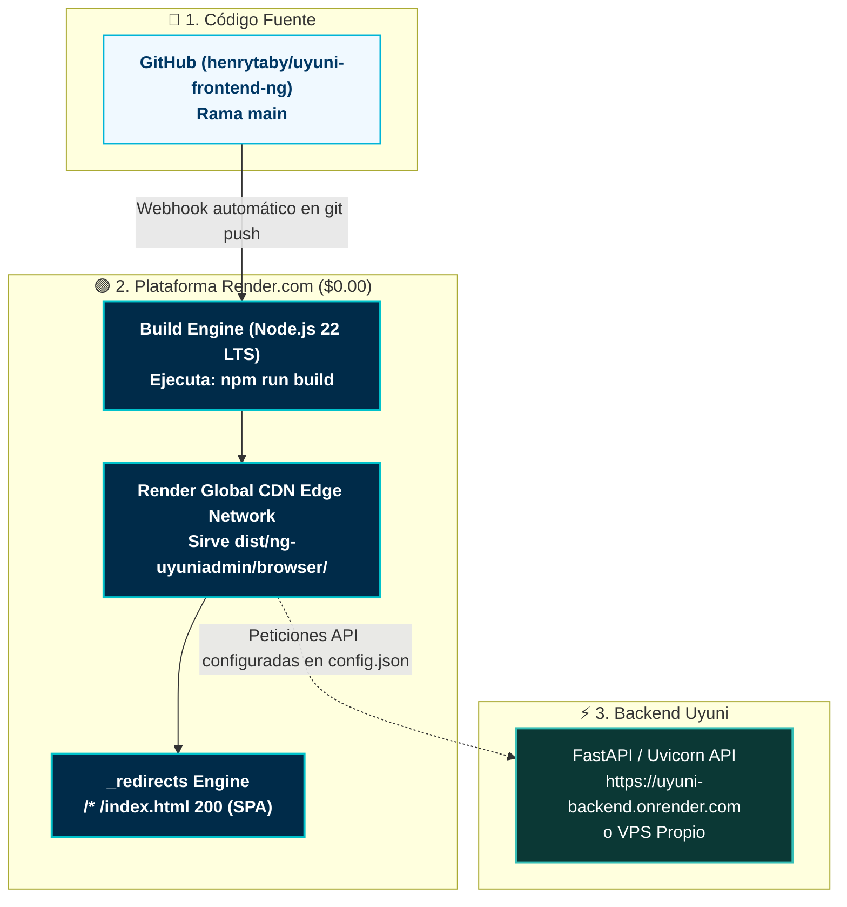

# Manual de Despliegue en Render.com (Static Site Gratuito) — Uyuni Frontend

Esta guía detalla el procedimiento paso a paso para desplegar **Uyuni Frontend (Angular 21)** en **[Render.com](https://render.com)** como un servicio **Static Site** totalmente gratuito (**$0.00 / mes**), con CDN global perimétrico, certificados SSL automáticos y despliegues automáticos en cada `git push`.

---

## 🏛️ Topología de Producción en Render.com ($0.00 / mes)



---

## 📋 Ventajas de Usar Render Static Site
* **100% Gratuito de por vida ($0.00 / mes):** A diferencia de los Web Services en Render (que se suspenden tras 15 minutos de inactividad), los **Static Sites de Render NO duermen jamás**.
* **Tráfico Ilimitado:** 100 GB de ancho de banda gratuito mensual.
* **Certificado SSL Automático:** Let's Encrypt administrado y renovado automáticamente.
* **Soporte Nativo de SPA:** El archivo `public/_redirects` se incluye automáticamente en la compilación para resolver el enrutamiento de Angular.

---

## 🚀 Paso a Paso de Despliegue en Render

### Paso 1: Iniciar Sesión en Render y Conectar GitHub

1. Ingresa a [https://dashboard.render.com/](https://dashboard.render.com/) e inicia sesión con tu cuenta de GitHub.
2. En el panel principal, haz clic en el botón **New +** y selecciona **Static Site**:

```text
[ New + ] 
   ├── Web Service
   ├── PostgreSQL
   └── 🌐 Static Site  👈 SELECCIONAR ESTE
```

3. Elige tu repositorio `uyuni-frontend-ng` (o el repositorio clonado para tu cliente).

---

### Paso 2: Configuración del Servicio Static Site

Completa los campos del formulario con los siguientes valores exactos:

| Parámetro | Valor Exacto | Explicación |
| :--- | :--- | :--- |
| **Name** | `uyuni-admin-app` (o el nombre de tu cliente) | Nombre del servicio en tu dashboard |
| **Branch** | `main` | Rama que disparará los despliegues automáticos |
| **Root Directory** | *(Dejar vacío)* | Raíz del proyecto |
| **Build Command** | `npm run build` | Comando de compilación optimizada de Angular 21 |
| **Publish Directory** | `dist/ng-uyuniadmin/browser` | **CRÍTICO:** Directorio donde Angular 21 genera el `index.html` y los chunks |

> [!CAUTION]
> **Atención al Publish Directory en Angular 21:**
> En Angular v21 el compilador `@angular/build:application` genera los archivos dentro de `dist/<nombre-proyecto>/browser/`. Si colocas únicamente `dist/ng-uyuniadmin`, Render no encontrará el `index.html` y mostrará error 404. Asegúrate de colocar:  
> `dist/ng-uyuniadmin/browser`

---

### Paso 3: Configurar la URL de la API de Producción

En **Uyuni Frontend**, la configuración se gestiona dinámicamente mediante `public/assets/config/config.json`. Tienes dos opciones para definir tu URL de producción:

#### Opción A: Inyección Dinámica por Variable de Entorno en Render (Recomendada)
Para que no tengas que modificar archivos de código, puedes configurar el **Build Command** en Render para que inyecte la URL de la API antes de compilar:

1. Ve a la pestaña **Environment** en tu servicio de Render y añade:
   * Key: `API_URL`
   * Value: `https://uyuni-backend-empresa.onrender.com` (o la URL de tu API)
2. Cambia el **Build Command** por:
   ```bash
   sed -i 's|"apiUrl": ".*"|"apiUrl": "'"$API_URL"'"|g' public/assets/config/config.json && sed -i 's|"mockAuth": true|"mockAuth": false|g' public/assets/config/config.json && npm run build
   ```

#### Opción B: Commit Directo en el Repositorio
Si prefieres no usar variables en el build, simplemente edita `public/assets/config/config.json` antes de hacer push:
```json
{
  "apiUrl": "https://uyuni-backend-empresa.onrender.com",
  "featureFlags": {
    "mockAuth": false
  }
}
```

---

### Paso 4: Desplegar

1. Haz clic en **Create Static Site**.
2. Render clonará el repositorio, ejecutará `npm run build` y publicará los archivos en su red CDN perimetral.
3. Al finalizar verás el estado en verde: **`Live`**.
4. Tu aplicación estará disponible de inmediato en una URL gratuita:  
   `https://uyuni-admin-app.onrender.com`

---

### Paso 5: Verificación de Redirecciones SPA (Rutas Profundas)

El proyecto incluye en su carpeta `public/` el archivo `_redirects` con la siguiente regla:

```text
/*    /index.html   200
```

Al compilar, este archivo se copia a `dist/ng-uyuniadmin/browser/_redirects`. Render lo detecta automáticamente.

**Prueba de Fuego:**
1. Abre tu aplicación y navega a `/signin`, `/profile` o `/users`.
2. Presiona recargar (`F5` o `Cmd+R`).
3. La página debe recargar de inmediato el componente correspondiente **sin mostrar error 404**.

---

### Paso 6: Configurar Dominio Personalizado (Opcional)

1. En tu panel de Render, ve a la sección **Custom Domains** y haz clic en **Add Custom Domain**.
2. Ingresa tu subdominio (ej: `admin.tuempresa.com`).
3. En tu proveedor de DNS (Cloudflare, GoDaddy, Namecheap, etc.), crea un registro tipo `CNAME`:
   * **Nombre:** `admin`
   * **Tipo:** `CNAME`
   * **Destino:** `uyuni-admin-app.onrender.com`
4. Render validará el registro y emitirá un certificado SSL gratuito de Let's Encrypt en cuestión de minutos.

