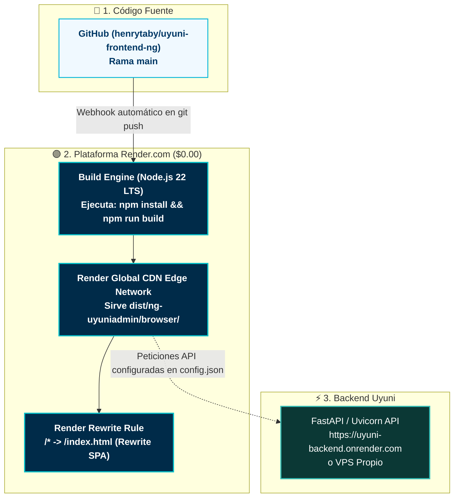

# Manual de Despliegue en Render.com (Static Site Gratuito) — Uyuni Frontend

Esta guía detalla el procedimiento paso a paso para desplegar **Uyuni Frontend (Angular 21)** en **[Render.com](https://render.com)** como un servicio **Static Site** totalmente gratuito (**$0.00 / mes**), con CDN global perimétrico, certificados SSL automáticos y despliegues automáticos en cada `git push`.

---

## 🏛️ Topología de Producción en Render.com ($0.00 / mes)



---

## 📋 Ventajas de Usar Render Static Site
* **100% Gratuito de por vida ($0.00 / mes):** A diferencia de los Web Services en Render (que se suspenden tras 15 minutos de inactividad), los **Static Sites de Render NO duermen jamás**.
* **Tráfico Ilimitado:** 100 GB de ancho de banda gratuito mensual.
* **Certificado SSL Automático:** Let's Encrypt administrado y renovado automáticamente.
* **Soporte Nativo de SPA:** El archivo `public/_redirects` se incluye automáticamente en la compilación para resolver el enrutamiento de Angular.

---

## 🚀 Paso a Paso de Despliegue en Render

### Paso 1: Iniciar Sesión en Render y Conectar GitHub

1. Ingresa a [https://dashboard.render.com/](https://dashboard.render.com/) e inicia sesión con tu cuenta de GitHub.
2. En el panel principal, haz clic en el botón **New +** y selecciona **Static Site**:

```text
[ New + ] 
   ├── Web Service
   ├── PostgreSQL
   └── 🌐 Static Site  👈 SELECCIONAR ESTE
```

3. Elige tu repositorio `uyuni-frontend-ng` (o el repositorio clonado para tu cliente).

---

### Paso 2: Configuración del Servicio Static Site

Completa los campos del formulario con los siguientes valores exactos:

| Parámetro | Valor Exacto | Explicación |
| :--- | :--- | :--- |
| **Name** | `uyuni-admin-app` (o el nombre de tu cliente) | Nombre del servicio en tu dashboard |
| **Branch** | `main` | Rama que disparará los despliegues automáticos |
| **Root Directory** | *(Dejar vacío)* | Raíz del proyecto |
| **Build Command** | `npm install && npm run build` | **CRÍTICO:** Descarga dependencias y ejecuta la compilación optimizada de Angular 21 (disparando el `prebuild` automático) |
| **Publish Directory** | `dist/ng-uyuniadmin/browser` | **CRÍTICO:** Directorio donde Angular 21 genera el `index.html` y los chunks |

> [!CAUTION]
> **Atención al Publish Directory en Angular 21:**
> En Angular v21 el compilador `@angular/build:application` genera los archivos dentro de `dist/<nombre-proyecto>/browser/`. Si colocas únicamente `dist/ng-uyuniadmin`, Render no encontrará el `index.html` y mostrará error 404. Asegúrate de colocar:  
> `dist/ng-uyuniadmin/browser`

---

### Paso 3: Configurar la URL de la API de Producción

En **Uyuni Frontend**, la configuración se gestiona dinámicamente mediante `public/assets/config/config.json`. El proyecto incluye un hook de compilación automático (`scripts/prepare-config.js`) que garantiza la creación del archivo a partir de `config.example.json` si se trata de un clon limpio y le inyecta las variables de entorno de Render:

#### Opción A: Variables de Entorno en el Dashboard de Render (Recomendada y Automática)

1. En la configuración de tu servicio en Render, ve a la sección **Environment Variables** (o pestaña **Environment**).
2. Añade las siguientes variables:
   * **`API_URL`**: `https://tu-backend-uyuni.onrender.com/api` (o la URL de tu API en producción).
   * **`MOCK_AUTH`**: `false` (desactiva el modo mock para autenticar contra tu backend real).
3. Tu **Build Command** debe ser:
   ```bash
   npm install && npm run build
   ```
   *(Durante `npm run build`, el script `prebuild` detecta automáticamente `API_URL` y `MOCK_AUTH` y las inyecta en `public/assets/config/config.json` antes de que Angular compile).*

#### Opción B: Despliegue con Blueprint 1-Clic (`render.yaml`)

El repositorio incluye el archivo [render.yaml](file:///opt/uyuni/uyuni-frontend-ng/render.yaml) configurado para Render Blueprints. 

1. En el panel de Render, selecciona **New +** > **Blueprint**.
2. Conecta el repositorio `uyuni-frontend-ng`.
3. Render detectará automáticamente `render.yaml`, configurará el servicio como **Static Site**, las rutas de reescritura SPA y los encabezados de caché `Cache-Control`.
4. Define o confirma el valor de `API_URL` en pantalla y haz clic en **Apply**.

---

### Paso 4: Desplegar

1. Haz clic en **Create Static Site** (o **Apply** si usaste el Blueprint).
2. Render clonará el repositorio, ejecutará `npm install && npm run build` y publicará los archivos en su red CDN perimetral.

> [!NOTE]
> **Aviso de `npm audit` en la consola:** Durante la ejecución de `npm install`, es completamente normal ver mensajes de auditoría de paquetes en color rojo como `67 vulnerabilities (1 low, 43 moderate, 19 high, 4 critical)`. Esto **NO** es un error de compilación ni interrumpe el despliegue. El proceso continuará automáticamente con la compilación de Angular 21.

3. Al finalizar verás el estado en verde: **`Live`**.
4. Tu aplicación estará disponible de inmediato en una URL gratuita:  
   `https://uyuni-admin-app.onrender.com`

---

### Paso 5: Configurar Regla Rewrite en Render (CRÍTICO para SPAs en Render)

A diferencia de otras plataformas, Render no lee automáticamente archivos `_redirects` en sitios estáticos creados manualmente desde el dashboard. Debes registrar la regla de reescritura en el panel de Render:

1. En el menú lateral izquierdo de tu servicio en Render, haz clic en **Redirects/Rewrites**.
2. Haz clic en el botón **Add Rule**.
3. Completa los campos con estos valores exactos:
   * **Type:** `Rewrite` *(⚠️ Asegúrate de que sea Rewrite y NO Redirect, para que no cambie la URL visible en el navegador)*.
   * **Source:** `/*`
   * **Destination:** `/index.html`
4. Haz clic en **Save Changes**.

> [!TIP]
> Esta regla se aplica de forma **inmediata** (no requiere volver a compilar). En cuanto guardes los cambios, al recargar o ingresar directamente a `https://novalabs-bo.onrender.com/users` o `/profile`, Angular responderá de inmediato sin mostrar `Not Found`.

---

### Paso 6: Verificación de Enrutamiento (Rutas Profundas)

**Prueba de Fuego:**
1. Abre tu navegador e ingresa directamente a:  
   `https://novalabs-bo.onrender.com/signin` o `https://novalabs-bo.onrender.com/users`
2. Presiona recargar (`F5` o `Cmd+R`).
3. La página cargará el componente correspondiente de inmediato sin mostrar error 404 ni `Not Found`.

---

### Paso 7: Configurar Dominio Personalizado (Opcional)

1. En tu panel de Render, ve a la sección **Custom Domains** y haz clic en **Add Custom Domain**.
2. Ingresa tu subdominio (ej: `admin.tuempresa.com`).
3. En tu proveedor de DNS (Cloudflare, GoDaddy, Namecheap, etc.), crea un registro tipo `CNAME`:
   * **Nombre:** `admin`
   * **Tipo:** `CNAME`
   * **Destino:** `uyuni-admin-app.onrender.com`
4. Render validará el registro y emitirá un certificado SSL gratuito de Let's Encrypt en cuestión de minutos.

