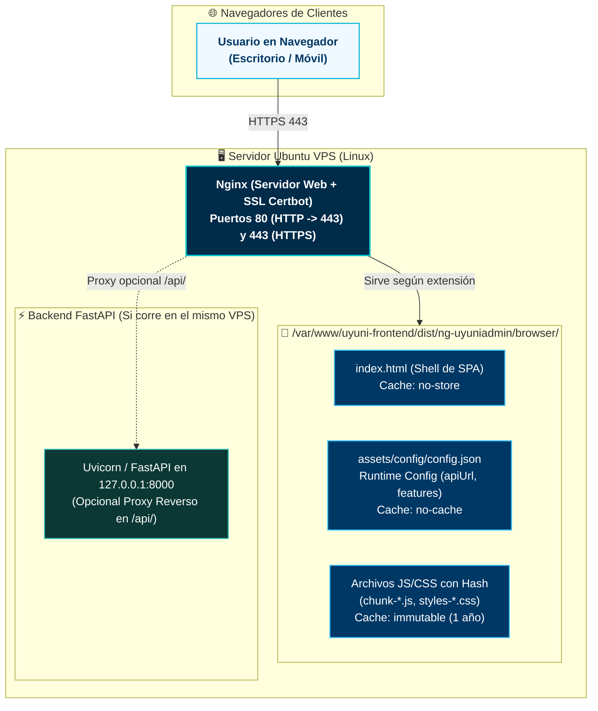

# Guía de Instalación y Despliegue en Servidor Ubuntu (VPS + Nginx) — Uyuni Frontend

Esta guía proporciona el procedimiento completo, paso a paso y listo para producción, para desplegar el frontend **UyuniAdmin (Angular 21 + PrimeNG 21 + Tailwind CSS v4)** en un servidor privado virtual (**VPS**) con **Ubuntu 22.04 LTS** o **Ubuntu 24.04 LTS** utilizando **Nginx** como servidor web de alto rendimiento.

---

## 🏗️ Arquitectura de Producción en VPS

En el servidor VPS, Nginx sirve los activos estáticos compilados de la Single Page Application (SPA), gestiona la compresión Gzip/Brotli, implementa políticas de caché HTTP inmutables y enruta todas las navegaciones cliente hacia `index.html`:



---

## 📋 Requisitos Previos

1. **Servidor VPS:** Mínimo 1 vCPU y 1 GB de RAM (recomendado 2 GB de RAM o activar 2 GB de Swap). Compatible con cualquier proveedor de VPS o servidor dedicado (DigitalOcean, Hetzner, AWS EC2, Linode, Contabo, Vultr, OVH o infraestructura privada/on-premise).
2. **Sistema Operativo:** Ubuntu 22.04 LTS o 24.04 LTS con acceso `sudo` o `root`.
3. **Dominio o Subdominio:** Un registro DNS tipo `A` que apunte a la IP pública de tu VPS (ejemplo: `admin.tudominio.com` o `app.tuempresa.com`).
4. **Backend Operativo:** La API de Uyuni (`uyuni-backend-py`) debe estar funcionando y accesible por HTTPS (ejemplo: `https://api.tudominio.com`).

---

## 🚀 Paso a Paso de Instalación

### Paso 1: Actualizar el Sistema y Configurar Memoria Swap

Si tu VPS cuenta con 1 GB de RAM, la compilación de Angular (`ng build`) puede agotar la memoria. Configurar 2 GB de memoria swap garantiza compilaciones 100% estables:

```bash
# Conectarse por SSH
ssh usuario@ip-de-tu-vps

# Actualizar paquetes del sistema
sudo apt update && sudo apt upgrade -y

# Verificar si ya existe swap
free -h

# Si no hay swap (Swap: 0B), crear archivo swap de 2 GB:
sudo fallocate -l 2G /swapfile
sudo chmod 600 /swapfile
sudo mkswap /swapfile
sudo swapon /swapfile

# Hacer permanente el swap tras reinicios
echo '/swapfile none swap sw 0 0' | sudo tee -a /etc/fstab
```

---

### Paso 2: Instalar Nginx, Git y Node.js 22 LTS

Instalaremos **Node.js 22 LTS** mediante el repositorio oficial de NodeSource y el servidor web **Nginx**:

```bash
# Instalar utilidades y Nginx
sudo apt install -y git curl ufw nginx

# Instalar Node.js 22 LTS (NodeSource)
curl -fsSL https://deb.nodesource.com/setup_22.x | sudo -E bash -
sudo apt install -y nodejs

# Verificar versiones instaladas
node -v    # Debe ser v22.x.x
npm -v     # Debe ser v10.x.x
nginx -v   # Debe mostrar nginx version
```

---

### Paso 3: Clonar el Repositorio en `/var/www`

```bash
# Crear directorio seguro para la aplicación
sudo mkdir -p /var/www/uyuni-frontend
sudo chown -R $USER:$USER /var/www/uyuni-frontend

# Clonar el proyecto
git clone https://github.com/henrytaby/uyuni-frontend-ng.git /var/www/uyuni-frontend
cd /var/www/uyuni-frontend
```

---

### Paso 4: Instalar Dependencias y Configurar el Entorno

> [!NOTE]
> En aplicaciones Angular, **NUNCA** utilices `--omit=dev` para la compilación, ya que el compilador `@angular/build` y las herramientas de CLI residen en `devDependencies`.

```bash
cd /var/www/uyuni-frontend

# Instalar dependencias exactas con clean install
npm ci

# Configurar el archivo de configuración en tiempo de ejecución
cp public/assets/config/config.example.json public/assets/config/config.json
```

Edita `public/assets/config/config.json` con tu editor preferido (`nano` o `vim`):

```bash
nano public/assets/config/config.json
```

Coloca la URL real de tu backend en producción y desactiva el modo de autenticación simulada (`mockAuth: false`):

```json
{
  "apiUrl": "https://api.tudominio.com",
  "authConfig": {
    "loginUrl": "/auth/login",
    "tokenKey": "access_token",
    "refreshKey": "refresh_token"
  },
  "appVersion": "1.0.3",
  "loggingLevel": "info",
  "featureFlags": {
    "enableSignup": true,
    "maintenanceMode": false,
    "mockAuth": false
  }
}
```

---

### Paso 5: Compilar el Proyecto para Producción

Ejecuta la construcción optimizada de Angular:

```bash
cd /var/www/uyuni-frontend
npm run build
```

El proceso generará los activos listos para producción en `/var/www/uyuni-frontend/dist/ng-uyuniadmin/browser/`:
* `index.html` (Shell principal)
* `assets/config/config.json` (Configuración de runtime)
* `chunk-*.js` y `styles-*.css` (Archivos con hash criptográfico para caché inmutable)

---

### Paso 6: Configurar Nginx para Single Page Application (SPA)

Crea un archivo de configuración de Nginx optimizado para aplicaciones Angular de alta densidad:

```bash
sudo nano /etc/nginx/sites-available/uyuni-frontend
```

Pega la siguiente configuración profesional (reemplaza `admin.tudominio.com` por tu dominio o subdominio real):

```nginx
server {
    listen 80;
    listen [::]:80;
    server_name admin.tudominio.com; # 👈 Reemplazar por tu dominio real

    root /var/www/uyuni-frontend/dist/ng-uyuniadmin/browser;
    index index.html;

    # =========================================================================
    # 🚀 Optimización de Compresión Gzip
    # =========================================================================
    gzip on;
    gzip_vary on;
    gzip_proxied any;
    gzip_comp_level 6;
    gzip_min_length 256;
    gzip_types
        application/atom+xml
        application/geo+json
        application/javascript
        application/x-javascript
        application/json
        application/ld+json
        application/manifest+json
        application/rdf+xml
        application/rss+xml
        application/vnd.ms-fontobject
        application/wasm
        application/x-web-app-manifest+json
        application/xhtml+xml
        application/xml
        font/eot
        font/otf
        font/ttf
        font/woff
        font/woff2
        image/bmp
        image/svg+xml
        image/vnd.microsoft.icon
        image/x-icon
        text/cache-manifest
        text/calendar
        text/css
        text/javascript
        text/markdown
        text/plain
        text/xml
        text/vcard
        text/vnd.rim.location.xloc
        text/vtt
        text/x-component
        text/x-cross-domain-policy;

    # =========================================================================
    # 🛡️ Cabeceras de Seguridad HTTP
    # =========================================================================
    add_header X-Frame-Options "SAMEORIGIN" always;
    add_header X-Content-Type-Options "nosniff" always;
    add_header X-XSS-Protection "1; mode=block" always;
    add_header Referrer-Policy "strict-origin-when-cross-origin" always;

    # =========================================================================
    # ⚡ 1. Archivo de Configuración de Runtime (NUNCA CACHEAR)
    # Debe ser consultado en vivo para que los cambios de API impacten al instante
    # =========================================================================
    location = /assets/config/config.json {
        add_header Cache-Control "no-store, no-cache, must-revalidate, proxy-revalidate, max-age=0" always;
        expires -1;
    }

    # =========================================================================
    # ⚡ 2. index.html (NUNCA CACHEAR)
    # Garantiza que el usuario reciba siempre las referencias a los nuevos chunks
    # =========================================================================
    location = /index.html {
        add_header Cache-Control "no-store, no-cache, must-revalidate, proxy-revalidate, max-age=0" always;
        expires -1;
    }

    # =========================================================================
    # ⚡ 3. Activos con Hash Criptográfico (JS, CSS, Fuentes, Imágenes)
    # Caché Inmutable de 1 Año (Máximo Rendimiento de Carga y Lighthouse 100)
    # =========================================================================
    location ~* \.(?:css|js|woff2?|eot|ttf|otf|ico|png|jpg|jpeg|webp|avif|svg)$ {
        expires 1y;
        add_header Cache-Control "public, max-age=31536000, immutable";
        access_log off;
    }

    # =========================================================================
    # 🔄 4. Enrutamiento SPA (Single Page Application)
    # Redirige cualquier ruta (/users, /profile, /signin) hacia index.html
    # =========================================================================
    location / {
        try_files $uri $uri/ /index.html;
    }

    # Bloquear acceso a archivos ocultos (ej. .git)
    location ~ /\. {
        deny all;
        access_log off;
        log_not_found off;
    }
}
```

Habilitar el sitio y verificar la sintaxis de Nginx:

```bash
# Crear enlace simbólico
sudo ln -sf /etc/nginx/sites-available/uyuni-frontend /etc/nginx/sites-enabled/

# Deshabilitar el sitio por defecto si no se usa
sudo rm -f /etc/nginx/sites-enabled/default

# Probar la configuración de Nginx
sudo nginx -t

# Si el test es exitoso, recargar Nginx:
sudo systemctl reload nginx
```

---

### Paso 7: Configurar Certificados SSL Gratuitos con Certbot (Let's Encrypt)

Instala Certbot y genera el certificado HTTPS con renovación automática:

```bash
# Instalar Certbot con el plugin de Nginx
sudo apt install -y certbot python3-certbot-nginx

# Solicitar el certificado SSL
sudo certbot --nginx -d admin.tudominio.com

# Probar la renovación automática
sudo certbot renew --dry-run
```

Certbot actualizará automáticamente la configuración de Nginx para redirigir todo el tráfico HTTP a HTTPS de forma segura.

---

### Paso 8: Configurar Firewall (UFW)

Asegura el servidor permitiendo únicamente tráfico SSH, HTTP y HTTPS:

```bash
sudo ufw allow OpenSSH
sudo ufw allow 'Nginx Full'
sudo ufw --force enable
sudo ufw status
```

---

## 🔄 Procedimiento de Actualización Continua (Zero-Downtime)

Para aplicar cambios futuros del repositorio en tu servidor sin interrumpir el servicio, crea un script automatizado `deploy.sh`:

```bash
nano /var/www/uyuni-frontend/deploy.sh
```

Pega el siguiente contenido:

```bash
#!/bin/bash
set -e

echo "🚀 Iniciando actualización de Uyuni Frontend..."
cd /var/www/uyuni-frontend

# 1. Traer los últimos cambios
git fetch origin main
git reset --hard origin/main

# 2. Instalar dependencias si hubo cambios en package.json
npm ci

# 3. Compilar aplicación de producción
npm run build

# 4. Asegurar permisos correctos
sudo chown -R www-data:www-data /var/www/uyuni-frontend/dist/
sudo chmod -R 755 /var/www/uyuni-frontend/dist/

# 5. Recargar Nginx
sudo systemctl reload nginx

echo "✅ Despliegue completado con éxito en producción."
```

Hazlo ejecutable:

```bash
chmod +x /var/www/uyuni-frontend/deploy.sh
```

Cada vez que desees actualizar tu frontend a la última versión, ejecuta simplemente:

```bash
/var/www/uyuni-frontend/deploy.sh
```

---

## 🛠️ Diagnóstico y Solución de Problemas Comunes

### 1. Error 404 al recargar páginas internas (ej. `/profile` o `/users`)
* **Causa:** Nginx intenta buscar un archivo físico `/profile/index.html` que no existe en una SPA.
* **Solución:** Verifica que la directiva `try_files $uri $uri/ /index.html;` esté presente dentro de `location /` en `/etc/nginx/sites-available/uyuni-frontend`.

### 2. Error `JavaScript heap out of memory` durante `npm run build`
* **Causa:** El VPS se quedó sin memoria RAM durante el proceso de optimización y tree-shaking de Angular.
* **Solución:** Asegúrate de haber activado el archivo Swap de 2 GB (Paso 1). También puedes ejecutar la compilación limitando el heap:
  ```bash
  NODE_OPTIONS="--max-old-space-size=1536" npm run build
  ```

### 3. El frontend muestra errores de CORS al conectarse a la API
* **Causa:** El backend FastAPI no tiene autorizado el dominio del frontend en sus orígenes permitidos.
* **Solución:** En el backend (`uyuni-backend-py`), añade `https://admin.tudominio.com` a la variable de entorno `ALLOWED_ORIGINS` o en `core/config.py`.

