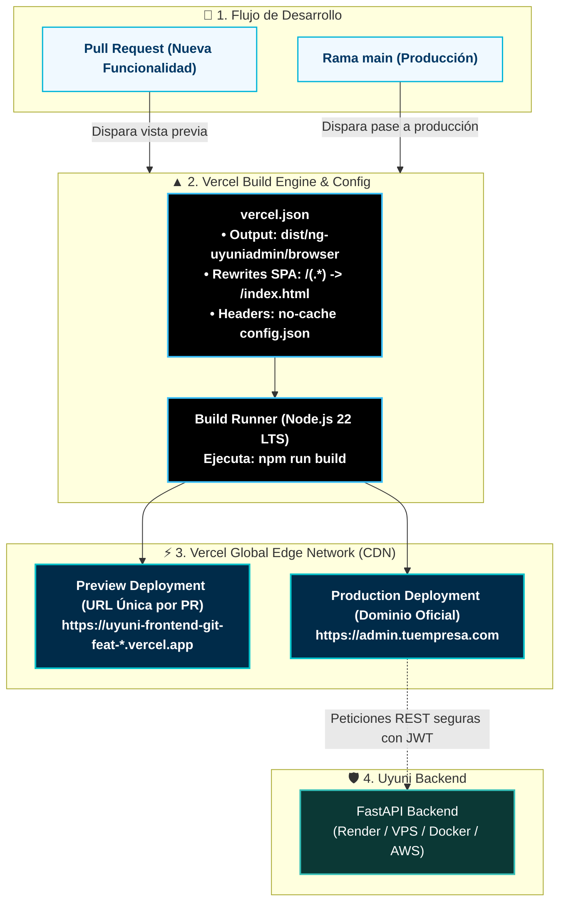

# Manual de Despliegue en Vercel (Edge Network) — Uyuni Frontend

Esta guía detalla el procedimiento para desplegar **Uyuni Frontend (Angular 21 + Tailwind v4 + PrimeNG 21)** en **[Vercel](https://vercel.com)** aprovechando su red CDN perimetral ultra rápida (**Edge Network**), despliegues automáticos por rama de Git y certificados SSL gestionados sin costo (**$0.00 / mes** en el plan Hobby).

---

## 🏛️ Topología en Vercel Edge Network



---

## 📋 Archivo de Configuración Oficial: `vercel.json`

El repositorio ya cuenta en su raíz con el archivo `vercel.json` configurado específicamente para la arquitectura Angular v21 de **UyuniAdmin**:

```json
{
  "$schema": "https://openapi.vercel.sh/vercel.json",
  "buildCommand": "npm run build",
  "outputDirectory": "dist/ng-uyuniadmin/browser",
  "framework": null,
  "rewrites": [
    {
      "source": "/(.*)",
      "destination": "/index.html"
    }
  ],
  "headers": [
    {
      "source": "/assets/config/config.json",
      "headers": [
        {
          "key": "Cache-Control",
          "value": "no-store, no-cache, must-revalidate, proxy-revalidate, max-age=0"
        }
      ]
    },
    {
      "source": "/index.html",
      "headers": [
        {
          "key": "Cache-Control",
          "value": "no-store, no-cache, must-revalidate, proxy-revalidate, max-age=0"
        }
      ]
    },
    {
      "source": "/(.*)\\.(js|css|woff2|png|svg|ico)",
      "headers": [
        {
          "key": "Cache-Control",
          "value": "public, max-age=31536000, immutable"
        }
      ]
    }
  ]
}
```

### ¿Qué resuelve esta configuración?
1. **`outputDirectory`: `dist/ng-uyuniadmin/browser`:** Le indica a Vercel la ruta exacta donde Angular 21 emite los activos compilados.
2. **`rewrites`:** Redirige todas las rutas profundas de la SPA (`/profile`, `/users`, `/signin`) hacia `/index.html`, evitando errores 404 al recargar el navegador.
3. **`headers`:**
   * Garantiza que `config.json` e `index.html` **jamás se queden cacheados** en el navegador del cliente cuando actualices la URL de la API o despliegues una nueva versión.
   * Aplica caché inmutable de 1 año (`max-age=31536000, immutable`) a los archivos JavaScript y CSS que ya cuentan con hash en su nombre.

---

## 🚀 Método 1: Despliegue con Integración de Git (Recomendado)

### Paso 1: Importar Repositorio en Vercel

1. Ingresa a [https://vercel.com/dashboard](https://vercel.com/dashboard) e inicia sesión con tu cuenta de GitHub.
2. Haz clic en **Add New...** > **Project**.
3. En la lista de repositorios, busca `uyuni-frontend-ng` y haz clic en **Import**.

---

### Paso 2: Configuración del Proyecto en el Dashboard de Vercel

Gracias al archivo `vercel.json`, Vercel preconfigurará automáticamente el proyecto. Solo verifica:

* **Project Name:** `uyuni-admin` (o el nombre de tu cliente)
* **Framework Preset:** `Other` (controlado por `vercel.json`)
* **Root Directory:** `./`
* **Build Command:** `npm run build`
* **Output Directory:** `dist/ng-uyuniadmin/browser`

---

### Paso 3: Configurar URL de Backend para Producción

Para que el frontend se comunique con tu API real en producción:

#### Opción Recomendada (Inyección Automática en Build):
En el panel de **Environment Variables** en Vercel, añade:
* **Key:** `API_URL`
* **Value:** `https://api.tuempresa.com` (o tu URL de Render / VPS)

Y activa la casilla **Override** en el campo **Build Command**:
```bash
sed -i 's|"apiUrl": ".*"|"apiUrl": "'"$API_URL"'"|g' public/assets/config/config.json && sed -i 's|"mockAuth": true|"mockAuth": false|g' public/assets/config/config.json && npm run build
```

---

### Paso 4: Desplegar y Publicar

1. Haz clic en el botón azul **Deploy**.
2. Vercel compilará la aplicación en aproximadamente 40 a 60 segundos.
3. Al finalizar, serás redirigido a la pantalla de felicitaciones con tu dominio asignado:  
   `https://uyuni-admin.vercel.app`

---

## ⚡ Método 2: Despliegue Inmediato desde la Terminal (Vercel CLI)

Si deseas publicar directamente desde tu terminal local o entorno de desarrollo sin pasar por Git:

```bash
# 1. Instalar Vercel CLI globalmente o ejecutar con npx
npx vercel login

# 2. Despliegue a entorno de prueba (Preview)
npx vercel

# 3. Despliegue directo a Producción
npx vercel --prod
```

---

## 🌐 Configuración de Dominio Personalizado

1. En tu proyecto de Vercel, dirígete a **Settings** > **Domains**.
2. Escribe tu dominio o subdominio deseado (ej. `admin.tuempresa.com`) y haz clic en **Add**.
3. En tu proveedor de DNS (Cloudflare, GoDaddy, Hostinger, etc.), crea el registro DNS solicitado por Vercel:
   * **Tipo:** `CNAME`
   * **Nombre:** `admin`
   * **Valor:** `cname.vercel-dns.com`
4. Vercel verificará la propagación DNS en segundos y emitirá el certificado SSL automáticamente.

