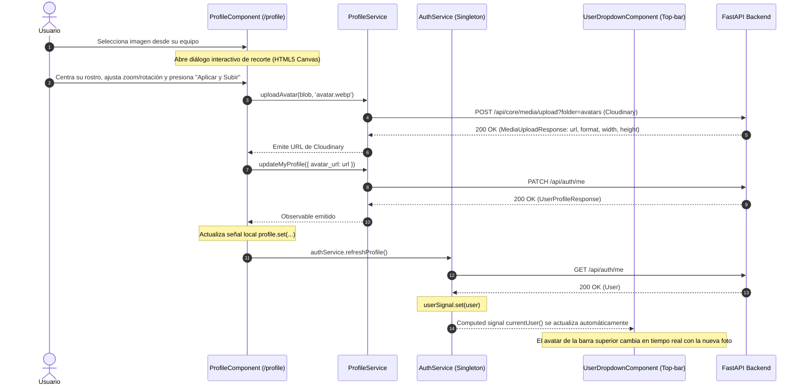
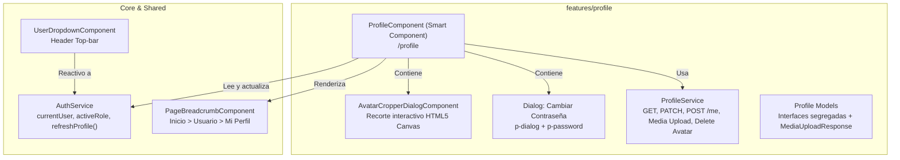

# 👤 Módulo de Autoservicio y Mi Perfil (`features/profile`)

Documentación técnica y operativa integral del módulo de perfil de usuario, gestión de preferencias personales y cambio de contraseña. Dirigida a **Managers**, **Arquitectos de Software**, **Tech Leads**, **Desarrolladores Senior** y **Desarrolladores Junior** que ingresan al proyecto.

---

## 📌 Tabla de Contenidos
1. [Resumen Ejecutivo y Modelo de Seguridad (Anti-IDOR)](#1-resumen-ejecutivo-y-modelo-de-seguridad-anti-idor)
2. [Arquitectura Técnica y Diagramas](#2-arquitectura-técnica-y-diagramas-arquitectos)
3. [Estructura de Archivos y Componentes](#3-estructura-de-archivos-y-componentes-developers)
4. [Ergonomía de UX y Decisiones de Diseño](#4-ergonomía-de-ux-y-decisiones-de-diseño)
5. [Hacks, Gotchas y Trampas Comunes](#5-hacks-gotchas-y-trampas-comunes-junior--mantenimiento)
6. [Guía de Mantenimiento y Extensión](#6-guía-de-mantenimiento-y-extensión)

---

## 1. Resumen Ejecutivo y Modelo de Seguridad (Anti-IDOR)

El módulo **Mi Perfil** permite a cualquier colaborador u operador del sistema consultar y actualizar su información personal y credenciales de acceso de forma autónoma.

### 🛡️ Seguridad Crítica: Autoservicio vs Gestión Administrativa

```text
┌───────────────────────────────────────────────┬───────────────────────────────────────────────┐
│  🛡️ GESTIÓN ADMINISTRATIVA (/users)           │  👤 AUTOSERVICIO / MI PERFIL (/profile)       │
├───────────────────────────────────────────────┼───────────────────────────────────────────────┤
│ • URL: /api/core/users/{id}                   │ • URL: /api/auth/me                           │
│ • Requiere: Permiso administrativo y rol.     │ • Requiere: Cualquier usuario autenticado.    │
│ • Requiere ID en URL: Sí (ej. UUIDv7).        │ • Requiere ID en URL: NUNCA (Cero ID).        │
│ • Alcance: Modificar roles, superusuario,     │ • Alcance: Solo sus propios datos personales  │
│   activar/desactivar cuentas ajenas.          │   (nombre, teléfono, avatar, ciudad, país).   │
│ • Mecanismo Anti-IDOR: N/A                    │ • Mecanismo Anti-IDOR: Garantizado por JWT.   │
└───────────────────────────────────────────────┴───────────────────────────────────────────────┘
```

> [!IMPORTANT]
> **Garantía Anti-IDOR (Insecure Direct Object Reference):**
> Los endpoints de autoservicio (`/api/auth/me` y `/api/auth/me/change-password`) jamás reciben identificadores en los parámetros de URL ni en el body. El backend extrae la identidad del usuario directamente desde la firma criptográfica del token JWT (`Authorization: Bearer <token>`). Es criptográficamente imposible suplantar o modificar el perfil de otro usuario a través de este módulo.

---

## 2. Arquitectura Técnica y Diagramas (Arquitectos)

### 2.1 Flujo de Datos y Sincronización Global de Sesión

Cuando un usuario actualiza su foto de perfil o nombre en `/profile`, los cambios deben impactar inmediatamente en el avatar y nombre del encabezado superior sin necesidad de recargar la página (`F5`).



### 2.2 Arquitectura de Componentes del Módulo



---

## 3. Estructura de Archivos y Componentes (Developers)

```text
src/app/features/profile/
├── components/
│   └── avatar-cropper-dialog/
│       ├── avatar-cropper-dialog.component.html # Canvas interactivo HTML5 con máscara circular y zoom
│       └── avatar-cropper-dialog.component.ts   # Transformaciones, drag/pan y exportación WebP
├── models/
│   └── profile.model.ts                         # Contratos: UserProfileResponse, UserProfileUpdatePayload, MediaUploadResponse
├── pages/
│   └── overview/
│       ├── profile.component.html               # Vista 2-columnas enterprise, header con avatar interactivo
│       └── profile.component.ts                 # Smart component OnPush, dirty checking y orquestación
├── services/
│   ├── profile.service.ts                       # Cliente HTTP para /api/auth/me y /api/core/media/upload
│   └── profile.service.spec.ts                  # Pruebas unitarias completas Jest (6 tests)
└── profile.routes.ts                            # Enrutamiento lazy load
```

### Componentes Involucrados en Shared

* [`src/app/shared/components/header/user-dropdown/user-dropdown.component.html`](../../src/app/shared/components/header/user-dropdown/user-dropdown.component.html):
  Menú superior de sesión. Muestra avatar/iniciales, rol actual, acceso a *"Mi Perfil"* y *"Cerrar sesión"*.
* [`src/app/shared/components/header/user-dropdown/user-dropdown.component.ts`](../../src/app/shared/components/header/user-dropdown/user-dropdown.component.ts):
  Controlador del menú de usuario desacoplado de opciones no implementadas.

---

## 4. Ergonomía de UX y Decisiones de Diseño

El rediseño de este módulo se basó en estándares de aplicaciones empresariales líderes (Stripe, GitHub, Linear, Supabase):

### 4.1 Miga de Pan (Breadcrumb) Corregida
* `app-page-breadcrumb` incluye nativamente el nodo raíz *"Inicio"*.
* Se configuró con `[items]="[{ label: 'Usuario' }, { label: 'Mi Perfil' }]"` para evitar repeticiones accidentales (`Inicio > Inicio`).

### 4.2 Unificación de Botones y Detección de Cambios (`isDirty`)
* **Problema resuelto:** Anteriormente existían múltiples botones de "Guardar Cambios" y "Cambiar Contraseña" dispersos en la pantalla, confundiendo al usuario sobre qué guardaba cada uno.
* **Solución aplicada:**
  1. **Un solo botón de Guardar:** Ubicado en la barra inferior del formulario de datos personales y ubicación.
  2. **Dirty Checking:** La señal computada `isDirty()` monitorea en tiempo real si algún campo fue alterado respecto a los datos cargados desde el servidor. Si no hay cambios, el botón permanece deshabilitado.
  3. **Botón Descartar:** Permite restaurar de inmediato los valores originales del servidor en caso de equivocación.
  4. **Un solo botón de Contraseña:** Ubicado en la tarjeta lateral "Seguridad y Credenciales", su contexto natural.

### 4.3 Desplegables con Búsqueda Integrada (`[filter]="true"`)
* Los selectores de **País** y **Zona Horaria** utilizan componentes PrimeNG v21 con filtrado instantáneo:
  ```html
  <p-select [filter]="true" filterBy="label" filterPlaceholder="Buscar país..." ...></p-select>
  ```
* Permite al usuario tipear directamente (ej. *"bol"*, *"esp"*, *"mex"*) sin necesidad de navegar manualmente listas extensas.

### 4.4 Encabezado de Identidad y Gestión de Avatar Estilo Facebook
* **Patrón de Industria Aplicado:** Inspirado en la arquitectura visual de perfil de Facebook y redes enterprise:
  * **Avatar de Gran Impacto:** Círculo ampliado de 128px en móvil a 160px en escritorio (`w-32 h-32 sm:w-36 sm:h-36 md:w-40 md:h-40`) con borde blanco de 4px, sombra suave y dot verde de cuenta activa.
  * **Badge de Cámara Integrado:** Botón circular (`h-9 w-9 sm:h-10 sm:w-10 md:h-11 md:w-11`) anclado en la esquina inferior derecha del avatar (`absolute bottom-0.5 right-0.5 sm:bottom-1 sm:right-1`), eliminando enlaces de texto toscos dispersos.
  * **Menú Contextual Inteligente:**
    * Si el usuario no tiene avatar: Un clic en el badge abre directamente el explorador de archivos.
    * Si ya cuenta con avatar: Despliega un menú flotante con opciones: *"Cambiar foto"* y *"Eliminar foto"*, con cierre automático al hacer clic fuera.
  * **Diseño Responsivo Adaptativo:**
    * **Desktop (`md:` y superior):** Disposición horizontal limpia: Avatar e información personal a la izquierda; pills de Rol, ID de usuario con botón de copiado y botón *"Cambiar Contraseña"* alineados a la derecha.
    * **Mobile (`< md`):** Centrado vertical armónico: Avatar con su badge en el centro de la pantalla, nombre, verificación, correo y ubicación centrados, y barra inferior con roles y accesos rápidos adaptados a pantallas táctiles.
  * **Diálogo de Recorte Canvas Optimizado:**
    * El círculo de recorte aprovecha el 93% del lienzo (`CANVAS_SIZE = 340`, `CIRCLE_RADIUS = 155`, diámetro de 310px con solo 15px de margen).
    * Escala base configurada en modo `cover` (`(CIRCLE_RADIUS * 2) / minDim`) para que cualquier foto cargada cubra completamente el círculo sin franjas negras vacías en zoom 100%.
    * Zoom interactivo (30% a 400%), rotación en 90° y exportación matemática a WebP 400x400 px.

---

## 5. Hacks, Gotchas y Trampas Comunes (Junior & Mantenimiento)

> [!WARNING]
> Lee estas consideraciones antes de introducir cambios en `profile.component.ts` o en los servicios de autenticación.

### 💣 Trampa 1: Intentar enviar IDs en las URLs de autoservicio
* **El error común:** Un desarrollador junior podría intentar hacer `this.http.patch('/api/auth/me/' + userId, data)`.
* **Por qué falla:** La ruta `/api/auth/me` no acepta argumentos de ruta. Hacerlo resultará en error HTTP `404 Not Found` o `405 Method Not Allowed`.

### 💣 Trampa 2: Enviar campos restringidos en el payload de actualización
* **El error común:** Enviar el objeto completo del perfil (`UserProfileResponse`) directamente al método `updateMyProfile()`.
* **Por qué falla:** El esquema `UserProfileUpdate` en FastAPI tiene `extra="forbid"`. Si se envía `id`, `username`, `email`, `is_active` o `is_verified`, el backend rechaza la petición con código `422 Unprocessable Entity`.
* **El Fix:** Se definió la interfaz estricta `UserProfileUpdatePayload` que solo incluye los 8 campos permitidos.

### 💣 Trampa 3: Recargar la página con `window.location.reload()` para ver el avatar
* **Por qué es un antipatrón:** Provoca pérdida de estado en memoria, destruye la experiencia de Single Page Application (SPA) y genera parpadeos visuales en la interfaz.
* **El Fix Limpio:** Disparar `this.authService.refreshProfile()` en el callback exitoso. La señal reactiva `currentUser()` de `AuthService` propaga el nuevo avatar a todos los componentes suscritos de forma transparente y con cero recargas.

### 💣 Trampa 4: Restos de Módulos PrimeNG v17 en la carpeta de Profile
* **Por qué se eliminaron:** Los componentes `user-info-card`, `user-address-card` y `user-meta-card` eran restos de un mockup inicial que importaban `DialogModule`, `ButtonModule`, etc., los cuales generan advertencias en PrimeNG v21 (orientado 100% a standalone).

---

## 6. Guía de Mantenimiento y Extensión

### ¿Cómo agregar un nuevo campo de preferencia (ej. Tema Oscuro por defecto o Idioma)?
1. **Actualizar el contrato:** Agrega el campo en `UserProfileResponse` y `UserProfileUpdatePayload` dentro de `profile.model.ts`.
2. **Declarar la señal:** En `profile.component.ts`, añade `readonly theme = signal<string>('system');`.
3. **Incluir en Dirty Checking:** Agrega la comparación en `isDirty()`.
4. **Incluir en el Payload:** Añádelo al objeto enviado en `onSaveProfile()`.
5. **Añadir control UI:** En `profile.component.html`, añade el `<p-select>` con su `<label for="...">`.

### ¿Cómo ejecutar las pruebas unitarias del módulo?
```bash
# Ejecutar los tests unitarios de ProfileService
npm test -- src/app/features/profile/services/profile.service.spec.ts
```

