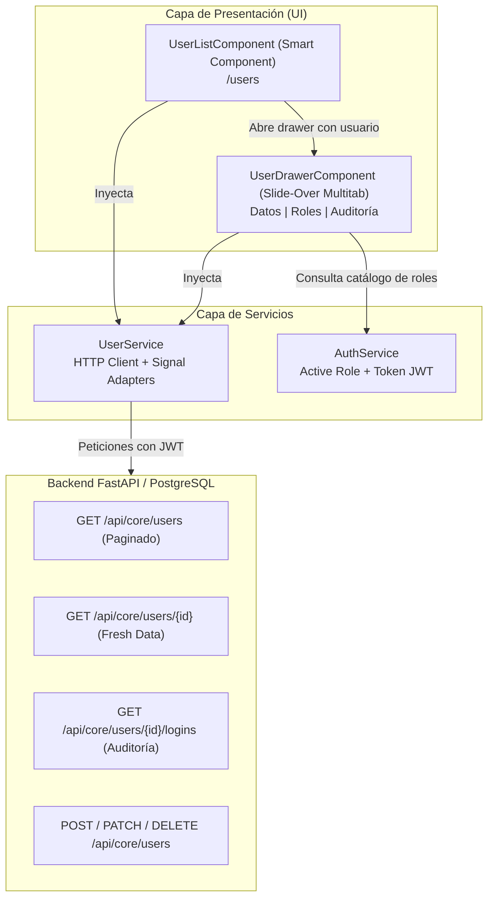
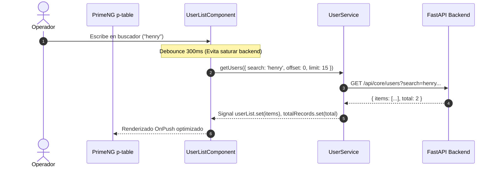

# 👥 Módulo de Gestión de Usuarios y Auditoría (`features/users`)

Documentación técnica y operativa integral del módulo de administración de usuarios, asignación de roles y auditoría de accesos. Dirigida a **Managers**, **Arquitectos de Software**, **Tech Leads**, **Desarrolladores Senior** y **Desarrolladores Junior** que ingresan al proyecto.

---

## 📌 Tabla de Contenidos
1. [Resumen Ejecutivo y Valor de Negocio](#1-resumen-ejecutivo-y-valor-de-negocio-managers--leads)
2. [Arquitectura Técnica y Diagramas](#2-arquitectura-técnica-y-diagramas-arquitectos)
3. [Estructura de Archivos y Componentes](#3-estructura-de-archivos-y-componentes-developers)
4. [Validaciones Estándar de la Industria](#4-validaciones-estándar-de-la-industria)
5. [Hacks, Gotchas y Trampas Comunes](#5-hacks-gotchas-y-trampas-comunes-junior--mantenimiento)
6. [Guía de Mantenimiento y Extensión](#6-guía-de-mantenimiento-y-extensión)

---

## 1. Resumen Ejecutivo y Valor de Negocio (Managers & Leads)

El módulo **Usuarios** es el núcleo de control de identidades y accesos administrativos (**IAM / RBAC**) de la plataforma UyuniAdmin.

```text
┌─────────────────────────────────────────────────────────────────────────────┐
│                           MÓDULO DE USUARIOS                                │
├──────────────────────┬──────────────────────────────┬───────────────────────┤
│  🔍 GESTIÓN          │  🛡️ SEGURIDAD Y ROLES        │  📜 AUDITORÍA Y TRAZA │
│  • Búsqueda debounce │  • Asignación de Roles       │  • Historial Logins   │
│  • Paginación Server │  • Superusuario On/Off       │  • Detección SO/Nav   │
│  • Filtros de Estado │  • Notas Administrativas     │  • Auditoría de IPs   │
└──────────────────────┴──────────────────────────────┴───────────────────────┘
```

### Capacidades Clave
* **Control Centralizado:** Permite dar de alta, modificar y suspender cuentas de operadores del sistema.
* **Seguridad Restringida (RBAC):** Solo operadores autenticados con permisos administrativos pueden interactuar con estos endpoints (`/api/core/users/*`).
* **Auditoría de Acceso Forense:** Muestra en tiempo real los inicios de sesión exitosos y fallidos, asociando dirección IP, navegador y sistema operativo para detección de anomalías o accesos no autorizados.
* **Separación de Contextos:** Este módulo es exclusivamente de **gestión administrativa corporativa**, claramente diferenciado del módulo de autoservicio (`/profile`).

---

## 2. Arquitectura Técnica y Diagramas (Arquitectos)

### 2.1 Flujo de Componentes y Estado
El módulo sigue el patrón **Smart / Dumb Component** y arquitectura **DDD Lite** sobre **Angular 21 (Standalone Components + Signals)**.



### 2.2 Ciclo de Vida de Paginación Lazy y Búsqueda Reactiva



---

## 3. Estructura de Archivos y Componentes (Developers)

```text
src/app/features/users/
├── components/
│   └── user-drawer/
│       ├── user-drawer.component.html   # Template con p-tabs v21, validaciones y diseño ERP
│       └── user-drawer.component.ts     # Lógica reactiva, dirty checking, effect guards
├── models/
│   └── user.model.ts                   # Interfaces TypeScript (User, CreatePayload, UpdatePayload, LoginLog)
├── pages/
│   └── user-list/
│       ├── user-list.component.html    # Tabla principal p-table con filtros y paginador
│       └── user-list.component.ts      # Controlador de lista y lazy loading
├── services/
│   ├── user.service.ts                 # Servicio HTTP con endpoints administrativos
│   └── user.service.spec.ts            # Pruebas unitarias Jest (100% cobertura)
└── users.routes.ts                     # Enrutamiento perezoso (loadComponent)
```

### Detalle de Responsabilidad por Archivo

| Archivo | Responsabilidad Principal |
| :--- | :--- |
| [`user.model.ts`](../../src/app/features/users/models/user.model.ts) | Define los contratos de datos: `User`, `UserCreatePayload`, `UserUpdatePayload`, `UserLoginLog`, `RoleCatalogItem`. |
| [`user.service.ts`](../../src/app/features/users/services/user.service.ts) | Cliente HTTP REST hacia `/api/core/users`. Gestiona paginación `offset/limit`, filtros de estado y auditoría de logins. |
| [`user-list.component.ts`](../../src/app/features/users/pages/user-list/user-list.component.ts) | Orquesta la tabla `p-table`, búsqueda reactiva con RxJS `debounceTime`, filtros de `activo`, `verificado` y `superusuario`. |
| [`user-drawer.component.ts`](../../src/app/features/users/components/user-drawer/user-drawer.component.ts) | Drawer lateral multitab. Contiene validaciones estrictas RFC, formateo de User-Agent y control de estado reactivo. |

---

## 4. Validaciones Estándar de la Industria

Para proteger la integridad de los datos y evitar inyecciones o errores de codificación en el backend, se implementaron validaciones estándar en tiempo real:

### 4.1 Nombre de Usuario (Username RFC)
* **Regla:** `/^[a-zA-Z0-9](?:[a-zA-Z0-9._-]*[a-zA-Z0-9])?$/`
* **Restricciones:**
  * Longitud entre 3 y 30 caracteres.
  * Cero espacios en blanco.
  * No puede comenzar ni terminar con puntos (`.`), guiones (`-`) o guiones bajos (`_`).
  * No permite símbolos especiales consecutivos (ej. `henry..taby` es rechazado).

### 4.2 Correo Electrónico (Anti-Homógrafos y Cumplimiento IDNA)
* **Regla:** Detección de caracteres no permitidos en nombres de dominio.
* **Restricciones:**
  * Debe contener exactamente un carácter `@`.
  * La parte local no puede tener espacios ni caracteres invisibles.
  * El dominio no puede contener homógrafos UTF-8 incompatibles con IDNA (ej. punto medio `·` como en `novabo.app@·gmail.com`, el cual genera fallo en validadores de DNS).
  * El botón **Guardar Cambios** se bloquea visualmente y resalta el campo con borde rojo si el correo o usuario son inválidos.

---

## 5. Hacks, Gotchas y Trampas Comunes (Junior & Mantenimiento)

> [!WARNING]
> Lee esta sección antes de modificar código en `user-drawer.component.ts`. Aquí están los problemas reales resueltos para evitar reintroducir bugs.

### 💣 Trampa 1: El bug de cambio de página en el historial reseteaba la pestaña a "Datos Generales"
* **Qué ocurría:** Cuando el usuario estaba en la pestaña 3 (*"Historial de Accesos"*) y cambiaba las filas por página (de 10 a 20 registros), la pantalla saltaba inesperadamente a la pestaña 0 (*"Datos Generales"*).
* **Por qué ocurría:** En Angular Signals, si un `effect()` lee una señal (como `this.loginRows()`), se suscribe a ella automáticamente. Al cambiar `loginRows()`, el `effect()` se re-ejecutaba creyendo que se abrió un nuevo usuario y reseteaba `this.activeTab.set('0')`.
* **El Fix (Hack Limpio):**
  1. Se utilizó `untracked(() => this.loginRows())` para consultar el valor sin registrar dependencia reactiva.
  2. Se agregó un guardia `isNewOpen = !this.lastVisibleState || this.lastOpenedUserId !== userId;` para que la pestaña solo se resetee cuando **realmente** se abre un usuario distinto desde la tabla.

### 💣 Trampa 2: Scroll horizontal no deseado por User-Agent largo
* **Qué ocurría:** El string `user_agent` enviado por navegadores es muy extenso (ej. `Mozilla/5.0 (Windows NT 10.0; Win64; x64) AppleWebKit/537.36 (KHTML, like Gecko) Chrome/157.0.0.0 Safari/537.36`), lo que rompía el ancho de la tabla y mostraba un scrollbar horizontal poco profesional.
* **El Fix:** Se definió una función parseadora `parseUserAgent()` que extrae el Sistema Operativo y Navegador (ej. *"Chrome en Windows 10/11"*), mostrando el icono del dispositivo, truncando el texto largo y colocando el User-Agent completo dentro de un `pTooltip`.

### 💣 Trampa 3: Error 422 por campos adicionales en Pydantic (`extra="forbid"`)
* **Qué ocurría:** Al enviar el payload a `POST /api/core/users` o `PATCH /api/core/users/{id}`, el backend respondía con `422 Unprocessable Entity`.
* **Por qué ocurría:** Los esquemas Pydantic del backend tienen `ConfigDict(extra="forbid")`. Si envías propiedades como `id`, `created_at` o `updated_at` en el body del JSON, FastAPI rechaza la petición.
* **El Fix:** Los payloads `UserCreatePayload` y `UserUpdatePayload` en `user.model.ts` son estrictos y solo contienen las propiedades permitidas.

---

## 6. Guía de Mantenimiento y Extensión

### ¿Cómo agregar un nuevo filtro en la tabla de usuarios?
1. En `user.model.ts`, agrega el parámetro opcional en `UserFilterParams` (ej. `country?: string`).
2. En `user-list.component.ts`, declara la señal para el filtro: `readonly selectedCountry = signal<string | null>(null);`.
3. En el método `loadData()`, añade el filtro al objeto de consulta:
   ```typescript
   if (this.selectedCountry()) params.country = this.selectedCountry()!;
   ```
4. En `user-list.component.html`, añade el `<p-select [filter]="true">` correspondiente en la barra de filtros.

### ¿Cómo ejecutar las pruebas unitarias del módulo?
```bash
# Ejecutar solo los tests del módulo de usuarios
npm test -- src/app/features/users/services/user.service.spec.ts

# Ejecutar con reporte de cobertura
npm test -- src/app/features/users/services/user.service.spec.ts --coverage
```

